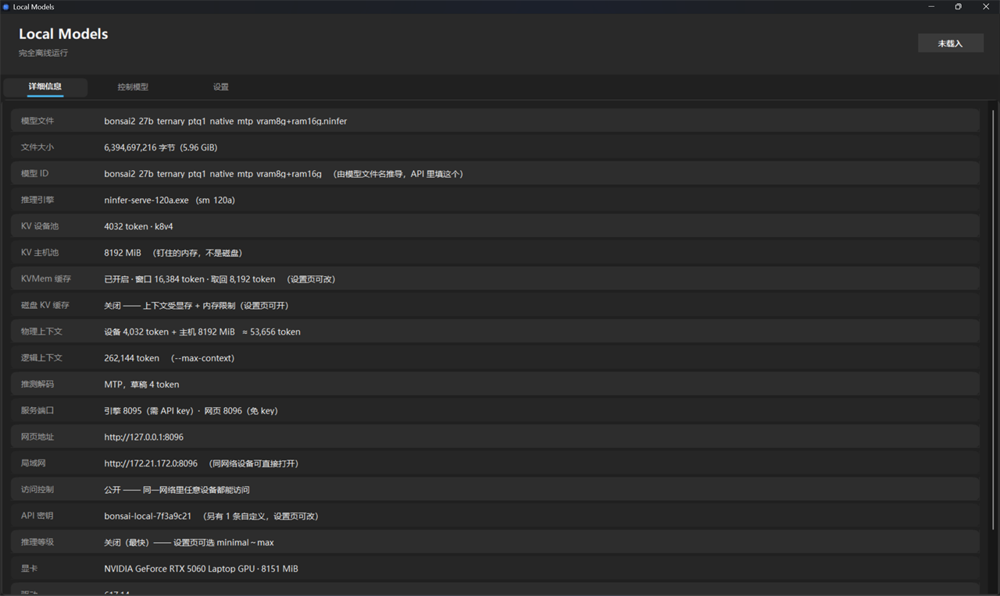
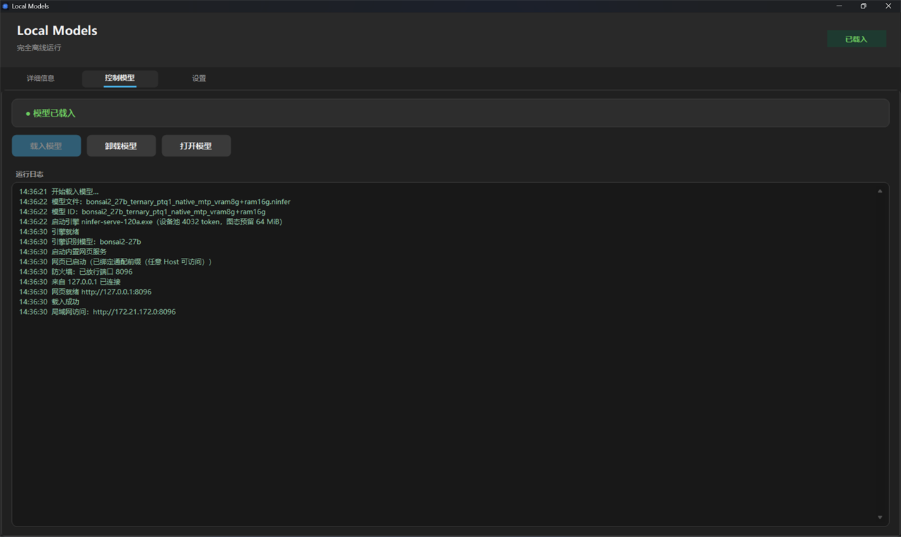
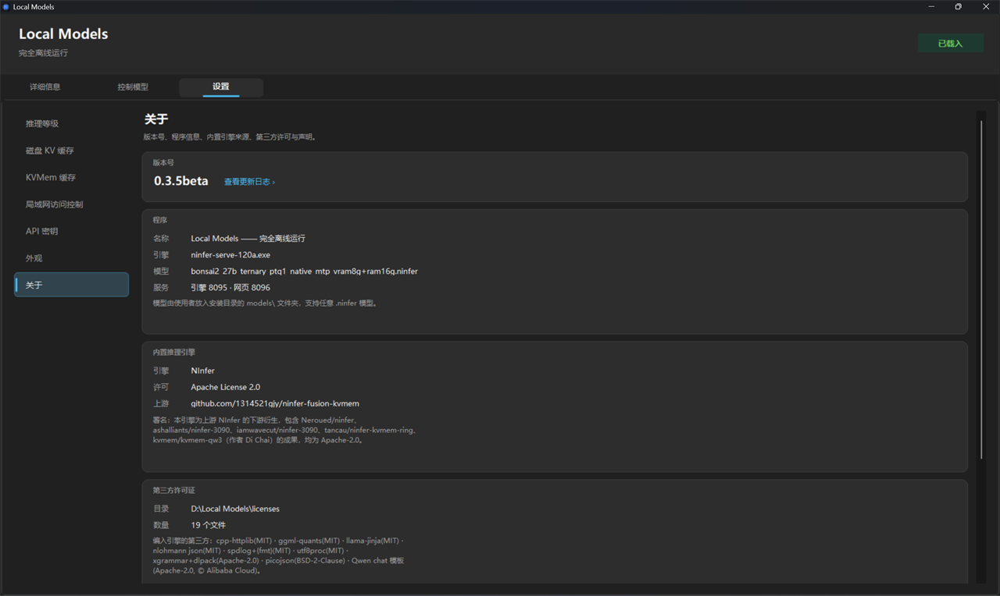

# Local Models

**一个跑在 Windows 上的本地大模型推理启动器：双击装上，托盘常驻，手机和电脑都能打开网页聊天，全程不联网。**

把 `.ninfer` 模型文件丢进 `models\` 文件夹就能用，不用命令行、不用配环境、不用装 node 或 Python。

当前版本：**0.4.0beta**

> **遇到问题或有建议？欢迎加 QQ 群 `373392086` 反馈。**
> 群里有其他用户在跑不同的显卡和模型，装不上、跑不动、报错都可以直接在群里问。

> **模型包下载**（123 云盘）：<https://123pan.cn/123pan/RdLYTd-GVFQA>
> 程序本身不含模型权重，需要单独下载。

---

## 界面截图

**详细信息** —— 载入模型后一眼看清用的是哪个引擎、KV 池多大、上下文能到多长：



**控制模型** —— 一键载入 / 卸载，右侧是实时运行日志：



**设置 · 关于** —— 版本号、引擎来源、第三方许可与声明：



---

## 特性

### 托盘启动器

窗口关掉程序还在跑，托盘图标常驻。右键菜单可以直接载入 / 卸载模型、开关网页服务、跳设置页。载入和卸载都是一键完成，不需要手动拼引擎参数。

### 内置网页聊天界面

聊天页面直接嵌在启动器 exe 里，**不需要额外装 node.js 或任何运行时**。浏览器打开就是完整对话界面，支持流式输出、Markdown 渲染、思考过程折叠。

网页对话气泡上会显示 **token 用量和生成速度**，方便判断模型状态。

### 局域网访问

同一网络下的手机、平板、另一台电脑，打开 `http://本机IP:8096` 就能直接用，不用在每台设备上装东西。

安装时会用 `netsh http add urlacl` 预留端口（这一步会弹一次 UAC），否则局域网访问会返回 400。

### KVMem 缓存

设置页可以调 **环形窗口**和**每次取回量**两个参数。填自定义值时界面会实时算出对应的内存占用，不用自己估。

### 磁盘 KV 缓存

打开之后，**上下文长度不再受显存和内存限制，改由磁盘空间决定**。适合处理超长文档或者很长的连续对话。

代价是速度会变慢（取回要读盘），所以默认关闭。缓存目录建议放在 SSD 上，机械硬盘会明显拖慢。

### 推理等级

可设置思考档位，按任务难度切换推理深度。在设置页下拉选择。

### 对话历史

对话记录自动保存到安装目录的 `对话历史.json`，**不依赖浏览器**。换浏览器、换设备打开看到的都是同一份记录。

支持多项目对话、历史列表、会话改名。每条会话还会记下当时的思考开关、档位、`max_tokens` 和温度。

### 多模型支持

模型 ID 就是 `models\` 里那个 `.ninfer` 文件的文件名（去掉扩展名），**一字不改**。

```
models\bonsai2_27b_ternary_ptq1_native_mtp.ninfer
        → 模型 ID: bonsai2_27b_ternary_ptq1_native_mtp
```

同一个 ID 同时给引擎的 `--model-id`、网页请求的 `model` 字段、界面显示三处使用。**换模型只需要换文件，ID 自动跟着变，不用改任何设置。**

### 显卡架构自适应

安装器会读本机显卡的计算能力，只释放匹配的那一档引擎，其余不落盘（省 3 GB 左右）。

| 计算能力 | 引擎 | 卡系 |
|---|---|---|
| `8.6` | `ninfer-serve-86.exe` | RTX 30 系 |
| `8.9` | `ninfer-serve-89.exe` | RTX 40 系 |
| `12.0` | `ninfer-serve-120a.exe` | RTX 50 系 |

不在表内的显卡（AMD / Intel / 更老的 GTX）**本程序不适用**，引擎只编了这三档。

### 外观与其它

- 浅色 / 深色 / 跟随系统，Win11 风格自绘菜单与选项卡
- 内置 API 密钥，设置页可自行增删
- 关于页列出程序信息、引擎来源、第三方许可

---

## 快速开始

### 1. 下载

到 [Releases](https://github.com/TinyDX/local-models/releases) 页面下载 **`Bonsai2-Setup.exe`**（约 100 KB）。

**不用再单独下引擎包** —— 安装程序会识别你的显卡架构，自动下载对应的那一个。
所以 RTX 50 系的用户只需要下 1.26 GB，而不是把三个架构的 4.2 GB 全下来。

> 如果 GitHub 下载太慢，安装向导的「引擎包」页里有下载源选择，可以换镜像，
> 也可以「手动选择本地文件」——自己用别的工具下好再指过去。

### 2. 安装

双击 `Bonsai2-Setup.exe`，跟着向导走 7 步：

```
欢迎 → 许可 → 硬件检查 → 安装选项 → 引擎包 → 安装中 → 完成
```

「引擎包」那一步会显示检测到的显卡和要下载的文件，点「下载」即可。
支持断点续传 —— 中途断了再点一次会接着下，不用从头来。

默认安装到 `C:\Program Files\Local Models`（本程序是 64 位应用，引擎是原生 x64，所以用 64 位的 Program Files，不是 `Program Files (x86)`）。在「浏览…」里选的目录会自动补一层 `\Local Models`。

静默安装（批量部署或脚本验证）：

```powershell
& 'Bonsai2-Setup.exe' /silent /dir "D:\某个目录"
```

> 静默模式需要一个已经下好的引擎包。用 `/kit "<路径>"` 指定：
> ```powershell
> & 'Bonsai2-Setup.exe' /silent /dir "D:\某个目录" /kit "D:\下载\infer-engine-sm120a-20261002.zip"
> ```

### 3. 放模型

**本包不含模型权重，需要自己准备。**

模型包下载地址（123 云盘）：

```
https://123pan.cn/123pan/RdLYTd-GVFQA
```

下好之后，把 `.ninfer` 文件放进安装目录的 `models\` 文件夹，程序会自动识别，不用改任何设置。

```
C:\Program Files\Local Models\models\你的模型.ninfer
```

> 模型 ID 就是文件名（去掉 `.ninfer` 后缀），程序自动推导。
> 可以放多个模型，在网页界面里切换。

### 4. 启动

从桌面 / 开始菜单快捷方式启动，或者直接运行安装目录里的 `Local Models.exe`。

程序会缩到托盘。在托盘菜单里载入模型，然后打开网页界面或者直接在窗口里对话。

### 5. 手机 / 局域网访问

在设置页打开「局域网访问控制」，然后在同一网络下的设备浏览器里访问：

```
http://本机IP:8096
```

---

## 从源码构建

### 环境要求

**只需要 Windows 自带的 .NET Framework 4.x**，不用装 Visual Studio，也不用装 .NET SDK。

编译器用的是系统自带的：

```
C:\Windows\Microsoft.NET\Framework64\v4.0.30319\csc.exe
```

### 一条命令编译

```powershell
# 全部四个
.\build.ps1 -Target all

# 或者只编其中一个
.\build.ps1 -Target launcher
.\build.ps1 -Target installer
.\build.ps1 -Target uninstaller
.\build.ps1 -Target updater
```

| Target | 产物 | 说明 |
|---|---|---|
| `launcher` | `Local Models.exe` | 启动器，网页页面一起嵌进去 |
| `installer` | `Bonsai2-Setup.exe` | 安装程序，6 步向导 / 支持 `/silent` |
| `uninstaller` | `Uninstall.exe` | 卸载程序，支持 `--quiet` |
| `updater` | `LocalModels-Update.exe` | 增量更新包，给已安装的用户 |

**编译顺序有讲究**：`updater` 内嵌的是**已经编译好的** exe 和更新日志，所以它必须最后编。`build.ps1 -Target all` 已经按正确顺序排好了。

### 源码目录约定

`build.ps1` 默认从 `src\` 读源码、输出到 `bin\`：

```
src\Version.cs      ← 三个 exe 都必须一起编译，漏了会报「找不到 AppInfo」
src\bonsai.ico      ← 图标，同时作为 win32icon 和嵌入资源
webui\index.html    ← 网页页面，编译时嵌进启动器
```

用 `-SourceDir` / `-OutDir` 可以改这两个路径。

### C# 5 语法限制

系统自带的是 .NET Framework 4.x 的 csc，**只支持 C# 5**。写代码时注意：

- ❌ 字符串插值 `$"a{b}"`
- ❌ `out var x`
- ❌ 表达式体成员 `int F() => 1;`
- ❌ `nameof(...)`、空条件运算符 `?.`、`$"..."`

改代码时踩了这些会直接编译报错。

---

## 项目结构

```
local-models\
├─ README.md                  本文件
├─ build.ps1                  一条命令编译三个（+更新器）exe
├─ NOTICE                     Apache-2.0 要求的署名与声明
├─ LICENSE                    Apache-2.0 许可证正文
├─ .gitignore
├─ docs\                      截图等文档资源
├─ webui\
│   └─ index.html             聊天页面（编译时嵌进启动器 exe）
├─ src\                       程序源码（C# 5 / .NET Framework 4.8）
│   ├─ Version.cs             版本号与产品名的唯一来源
│   ├─ BonsaiTray.cs          启动器主程序（托盘 + 窗口 + 引擎管理）
│   ├─ WebHost.cs             内置网页服务与 API 反代（零依赖）
│   ├─ Theme.cs               配色与 Win11 外观
│   ├─ Win11Menu.cs           右键菜单的 Win11 风格自绘
│   ├─ Win11Tabs.cs           选项卡的 Win11 风格自绘
│   ├─ W11Ui.cs               Win11 控件辅助
│   ├─ LaunchConfig.cs        读安装器写出的 launch-config.json
│   ├─ Hardware.cs            显卡探测（读计算能力，决定用哪档引擎）
│   ├─ AccessConfig.cs        局域网访问控制
│   ├─ ApiKeys.cs             API 密钥管理
│   ├─ Reasoning.cs           推理等级
│   ├─ DiskKv.cs              磁盘 KV 缓存
│   ├─ Kvmem.cs               KVMem 缓存
│   ├─ Installer.cs           安装程序（6 步向导 / /silent）
│   ├─ InstallCore.cs         安装动作核心（界面与静默模式共用）
│   ├─ Uninstall.cs           卸载程序（含 --quiet）
│   ├─ Updater.cs             增量更新逻辑
│   ├─ UpdaterForm.cs         更新器界面
│   ├─ UpdateMain.cs          更新器入口
│   └─ bonsai.ico             图标（7 个尺寸，256~16）
└─ bin\                       编译输出（已 gitignore）
```

### 安装后的目录

```
C:\Program Files\Local Models\
├─ Local Models.exe           启动器
├─ Uninstall.exe              卸载程序
├─ launch-config.json         安装器写出的配置
├─ 对话历史.json              聊天记录
├─ engine\                    推理引擎（按显卡架构过滤后只剩一档）
├─ licenses\                  第三方许可原文，请勿删除
├─ models\                    模型文件放这里
└─ webui\                     网页界面
```

运行时日志写在 `%LOCALAPPDATA%\LocalModels\engine.log`。

---

## 常见问题

### 模型应该放在哪？

放在**安装目录的 `models\` 文件夹**里，也就是 `C:\Program Files\Local Models\models\`。

文件名就是模型 ID，程序自动识别，不需要改任何配置。放进去了但列表里没出现，检查扩展名是不是 `.ninfer`。

本程序**不含模型权重**，`.ninfer` 与引擎是分开分发的，各自许可自负。

### 显存有什么要求？

引擎参数默认那份是按 **16 GB 卡**写的。**8 GB 卡上原样起不来**，引擎会在启动期拒绝并报出它需要的字节数，需要换一套参数配方。

另外 **CUDA 13.x 要求驱动 ≥ 580**，低于这个版本会报 `CUDA_ERROR_INSUFFICIENT_DRIVER`，先去更新显卡驱动。

开「磁盘 KV 缓存」可以绕开显存和内存对上下文长度的限制，代价是速度。

### 为什么这么慢？

按可能性从高到低排查：

1. **磁盘 KV 缓存开着**。取回要读盘，默认是关的，处理超长上下文才需要开。
2. **缓存目录在机械硬盘上**。换到 SSD 上会有明显改善。
3. **模型档位不匹配显卡**。小卡用了非 `-mtponly` 的模型族，或者反过来。
4. **图捕获失败**。部分 Windows / WDDM + 驱动组合下 CUDA graph 捕获会失败，会走绕道路径。实测绕道 `--no-cuda-graph` 的速度代价为 0，可以放心用。
5. **推理等级开太高**。思考档位越高，生成的 token 越多，体感越慢。
6. **模型太大**。27B 的模型在 8 GB 卡上无论如何都快不了。

### 卸载会删掉我的模型吗？

**不会。** `models\` 默认保留（那是使用者自己的模型文件），只有在卸载时**显式勾选**才会一起删。

对话历史 `对话历史.json` 卸载程序也不会自动删除，不需要的话手动清理。

### 换了模型之后要不要改设置？

不用。模型 ID 就是文件名，换文件即换模型，界面、引擎参数、网页请求三处自动一致。

### 局域网访问打不开？

1. 确认设置页里「局域网访问控制」是打开的。
2. 确认防火墙放行了端口。
3. 安装时那一步 `netsh http add urlacl` 是否弹过 UAC 并通过 —— 没预留的话局域网访问会返回 400。可以这样检查：

```powershell
netsh http show urlacl | Select-String 8096
```

### 支持哪些系统？

**仅支持 64 位 Windows 11。**

### 只更新程序，还要重下 4.5 GB 吗？

不用。用 `LocalModels-Update-*.exe` 增量包（几百 KB）即可跨版本更新。它会自动找安装目录、比对版本号、关掉正在运行的程序、替换程序文件。

**只替换程序文件**，`models\`、`engine\`、`licenses\`、各种 `.json` 配置和对话历史一律不动。

### 还是搞不定怎么办？

上面没覆盖到的问题，直接加 QQ 群 **`373392086`** 问。

反馈时最好带上这几样，能省很多来回：

- 显卡型号和显存（`nvidia-smi` 的输出）
- 用的是哪个包（`infer-engine-sm120a` / `sm89` / `sm86`）
- 程序里「控制模型」页的日志，或者安装目录下的 `engine.log`
- 具体报错内容（截图或文字都行）

---

## 许可证与致谢

本程序的推理能力来自 **NInfer**，采用 [Apache-2.0](https://www.apache.org/licenses/LICENSE-2.0) 许可。

> **上游仓库**：<https://github.com/1314521gjy/ninfer-fusion-kvmem>

本程序是上游 NInfer 的**下游衍生**，包含了以下贡献者的成果（均为 Apache-2.0）：

| 来源 | 角色 |
|---|---|
| [Neroued/ninfer](https://github.com/Neroued/ninfer) | NInfer 原始仓 |
| [ashalliants/ninfer-3090](https://github.com/ashalliants/ninfer-3090) | 引擎树 README 自称的基线 |
| [iamwavecut/ninfer-3090](https://github.com/iamwavecut/ninfer-3090) | `VERSION = 0.11.0-rtx3090` |
| [tancau/ninfer-kvmem-ring](https://github.com/tancau/ninfer-kvmem-ring) | KVMem 环原始线（代码已并入） |
| [kvmem/kvmem-qw3](https://github.com/kvmem/kvmem-qw3)（作者 **Di Chai**） | 策略层（改造版已并入） |
| [1314521gjy/ninfer-fusion-kvmem](https://github.com/1314521gjy/ninfer-fusion-kvmem) | 本引擎的融合与改动方 |

### 第三方组件

以下组件被编进了引擎二进制或作为运行库分发：

| 组件 | 许可 |
|---|---|
| cpp-httplib | MIT |
| ggml-quants | MIT |
| llama-jinja | MIT + Unicode License V3 |
| nlohmann json | MIT |
| spdlog（含 bundled fmt） | MIT |
| utf8proc | MIT (expat) |
| xgrammar | Apache-2.0 |
| dlpack | Apache-2.0 |
| picojson | BSD-2-Clause（许可嵌在头文件内） |
| Qwen chat 模板 | Apache-2.0，© Alibaba Cloud |
| CUDA 运行库（cublas / cublasLt / cudart） | NVIDIA |
| FFmpeg（avcodec / avformat / avutil / swresample / swscale） | GPL |
| libcurl | curl 许可 |

完整许可证原文随包放在安装目录的 `licenses\` 文件夹里，**请勿删除**。本仓库根目录的 [NOTICE](NOTICE) 文件列出了逐项署名与改动声明。

### 免责声明

本程序基于上游 Apache-2.0 项目打包，**上游未对本程序背书**。

本程序为个人本地推理工具，**所有计算都在本机完成，不联网、不上传任何内容**。

模型权重不在本仓库分发范围内，请自行获取并遵守对应模型的许可条款。

---

## 相关文档

- [更新日志](docs/更新日志.txt) —— 各版本的新增、修改与修复
- [构建与打包](docs/构建与打包.md) —— 目录结构、编译命令、设计要点
- [NOTICE](NOTICE) —— Apache-2.0 要求的署名与改动声明
- 安装目录 `licenses\` —— 第三方许可证原文
